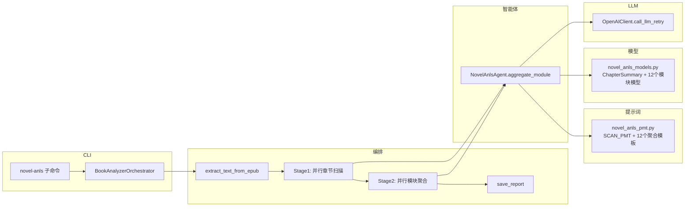
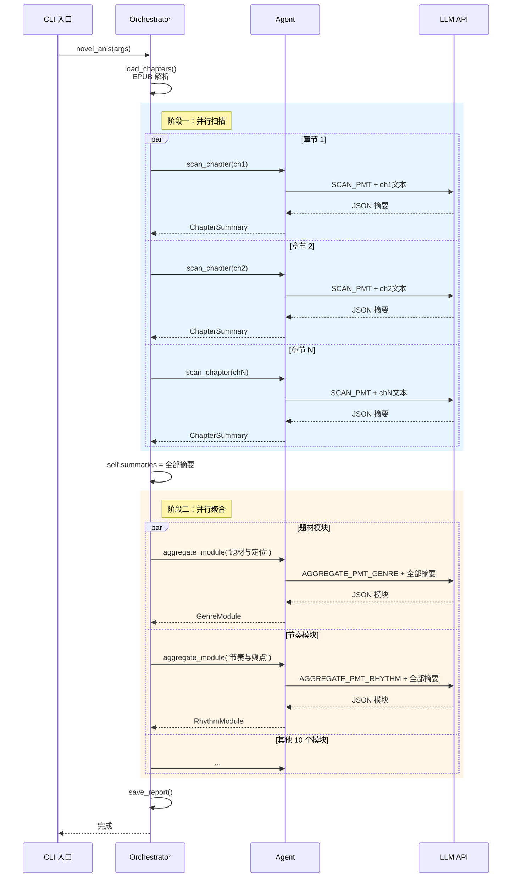

# 小说拆书工具技术文章

## 它到底在干什么？

你手里有一本几十万字的网络小说，想从中提炼出结构化的分析数据，甚至进一步构造出能喂给大模型做微调的训练样本。手动读、手动标注，几百章下来人直接废了。

这个工具的核心思路就一句话：**让 LLM 当"读书人"，把书一章一章读完，边读边做笔记，最后把全部笔记汇总成 12 个维度的分析报告**。

它不试图让模型一次性读完整本书（上下文塞不下），而是把任务拆成两层：

- **第一层（章节扫描）**：每章独立调用一次 LLM，只喂这一章的正文，让它输出一个结构化的"章节摘要"。几百章就是几百次调用，可以并发跑。
- **第二层（模块聚合）**：所有章节摘要都拿到后，再跑 12 个 LLM 调用，每个负责一个分析维度（题材、节奏、人物图谱……），把全书信息汇总成最终报告。

---

## 代码架构总览



四个文件各司其职：

| 文件 | 职责 | 类比 |
|---|---|---|
| `novel_anls.py` | 编排器，调度整个流程 | 项目经理 |
| `novel_anls_agent.py` | 智能体，封装 LLM 调用和解析 | 执行者 |
| `novel_anls_pmt.py` | 所有提示词模板 | 任务书 |
| `novel_anls_models.py` | 所有 Pydantic 数据模型 | 验收标准 |

---

## 智能体编排流程

### 整体时序



### 阶段一：并行章节扫描

用 `ThreadPoolExecutor` 并发跑所有章节，默认 8 个线程。每章是独立的 LLM 调用，互相不依赖，所以可以安全并发。

关键细节：结果按章节序号排序后存入 `self.summaries`，保证传给第二阶段的顺序稳定。

```python
# 单章扫描任务（线程池调用）
def _scan_single_chapter(self, chapter: Chapter) -> ChapterSummary:
    return chapter.index, self.agent.scan_chapter(
        chapter_index=chapter.index,
        chapter_title=chapter.title,
        chapter_text=chapter.text,
    )
```

### 阶段二：并行模块聚合

12 个模块彼此独立（每个只读全部章节摘要，不读其他模块），所以也可以并发，默认 10 个线程。

每个模块失败不影响其他模块——失败的结果被存为 `{"error": "..."}` 写进报告，不会中断整个流程。

### 字段级容错（parse 兜底）

LLM 输出 JSON 时偶尔会给出非法的枚举值（比如 `emotion_direction: "up2"`）。如果整个 `parse_obj_as` 因此报错，整章就废了。

所以 `parse` 回调里加了一层兜底：捕获 `ValidationError`，把出错的那个顶层字段置为 `None`，再重新校验一次。单字段出错不会拖垮整章。

```python
def parse(raw):
    data = json.loads(ext_code_block(raw))
    try:
        return parse_obj_as(ChapterSummary, data)
    except ValidationError as e:
        for err in e.errors():
            top_key = err["loc"][0]
            if top_key in data:
                data[top_key] = None   # 置 None 重试
        return parse_obj_as(ChapterSummary, data)
```

---

## 提示词设计

### 渲染机制

所有提示词模板用 `{占位符}` 表示动态内容，字面量花括号必须写成 `{{ }}`。渲染时用正则替换 `{xxx}`，`{{ }}` 还原成 `{ }`。

```python
# 模板里写：
"chapter_index": {chapter_index}    # 占位符，渲染时替换

# 模板里写：
"character_list": [{{"name": "..."}}]   # 字面量花括号，渲染后还原

# 渲染结果：
"chapter_index": 5
"character_list": [{"name": "..."}]
```

### 章节扫描提示词（SCAN_PMT）

这是整个系统里最复杂的提示词，要求模型从单章正文输出约 30 个字段。设计上有几个关键约束：

| 约束 | 原因 |
|---|---|
| `plot_node_list` 最多 5 条 | 防止模型列出几十条，浪费 token |
| `foreshadowing_payoff.set_chapter ≤ 当前章号` | 单章扫描看不到未来，只能报告"回收了之前哪章的伏笔" |
| `is_new` 明确区分首次登场 | 否则模型会把所有角色都标 `true` |
| 枚举字段无法判断填 `null` | 防止模型瞎猜 |
| P2 字段无法判断填 `null` 或 `[]` | 不要求模型编造数据 |
| `training_sample` 默认 `null` | 训练数据生成是独立 pipeline，扫描阶段不强制生成 |

输出格式部分直接给出完整的 JSON 结构示例，让模型照着填，大幅降低解析失败率。

### 模块聚合提示词（12 个）

每个模块一个独立的提示词模板，结构完全统一：

```
任务描述
输出格式（JSON 示例）
[content] 全部章节摘要 [/content]
[content] 书籍元信息 [/content]
```

章节摘要和书籍元信息用 `[content]...[/content]` 包裹，这是为了和"JSON 输出用三个反引号包裹"的约定区分开——模型输出 JSON 时知道要加反引号，输入上下文时知道内容是数据不是指令。

---

## 数据模型设计

### 层次结构

```mermaid
graph TD
    subgraph 基础模型
        Ch[Chapter<br/>EPUB 解析出的单章]
        BM[BookMeta<br/>书名/作者/简介]
    end

    subgraph 章节扫描
        CS[ChapterSummary<br/>章节摘要]
        PN[PlotNode<br/>事件节点]
        CB[CharacterBrief<br/>人物简述]
        CSC[CharacterStateChange<br/>状态变化]
        FS[ForeshadowingSet<br/>新埋伏笔]
        FP[ForeshadowingPayoff<br/>回收伏笔]
        TS[TrainingSample<br/>训练样本]
    end

    subgraph 全书模块 ×12
        GM[GenreModule]
        TM[TitleModule]
        WM[WorldModule]
        CM[CharacterModule]
        SM[StructureModule]
        RM[RhythmModule]
        GM2[GimmickModule]
        OM[OpeningModule]
        FM[ForeshadowModule]
        PM[PatternModule]
        STM[StyleModule]
        RAT[RatingModule]
    end

    subgraph 报告
        BAR[BookAnalysisReport<br/>完整报告]
        TDM[TrainingDatasetMeta<br/>训练数据元信息]
    end

    CS --> PN
    CS --> CB
    CS --> CSC
    CS --> FS
    CS --> FP
    CS --> TS
    BAR --> CS
    BAR --> TDM
    BAR --> GM
    BAR --> RM
    BAR --> STM
```

### 关键字段设计说明

**`ChapterSummary`（章节摘要）**

这是整个系统信息密度最高的模型，约 30 个字段。设计原则：

- **P0 字段**（`plot_node_list`、`character_list`、`foreshadowing_set` 等）：LLM 扫描时必须生成，默认空列表
- **P1 字段**（`sentence_pattern_features`）：可选，LLM 可以填也可以不填
- **P2 字段**（`paragraph_function_tags`、`key_dialogue_excerpt` 等）：实验性字段，默认 `null` 或 `[]`，不影响核心流程
- **`training_sample`**：嵌套的 `TrainingSample` 模型，默认 `None`。字段全部存在于 schema 中（满足"字段必须存在"的要求），但由后续数据 pipeline 填充，扫描阶段不强制生成

**`TrainingSample`（训练数据样本）**

约 40 个字段，覆盖 5 类数据：

| 字段组 | 示例字段 | 生成方 |
|---|---|---|
| 文本切分 | `chunk_id`、`chunk_text`、`segmentation_strategy` | 程序（orchestrator） |
| 指令构造 | `instruction`、`instruction_type`、`output`、`messages` | LLM 或模板 |
| 风格迁移 | `style_label`、`style_features`、`content_description` | LLM + 程序 |
| DPO 偏好 | `chosen`、`rejected`、`preference_dimension` | 独立 pipeline |
| Agent 轨迹 | `thought`、`action`、`step_index` | 独立 pipeline |

本次改动只保证 schema 存在，不要求扫描阶段生成这些字段。

**`TrainingDatasetMeta`（全书级训练数据元信息）**

由 orchestrator 的 `_build_training_dataset_meta()` 汇总生成，只在 CLI 传 `--build-training-meta` 时才构造。汇总的是所有章节 `training_sample` 的统计信息（样本数、任务分布、模板覆盖率等）。

### 12 个模块模型

每个模块都有固定的 `module: Literal[...]` 字段，用来标识自己属于哪个维度。聚合时 LLM 输出 JSON，`parse_obj_as` 会校验 `module` 字段的值是否匹配，不匹配就报错——这是一个很好的防错机制。

| 模块 | 模型 | 核心字段 |
|---|---|---|
| 题材与定位 | `GenreModule` | `genre_tags`（列表，不再是单值） |
| 书名与简介 | `TitleModule` | `one_sentence_pitch` |
| 世界观设定 | `WorldModule` | `story_core`、`core_theme` |
| 人物图谱 | `CharacterModule` | `character_relationship_graph`（Dict，不是字符串） |
| 主线与结构 | `StructureModule` | `antagonistic_force_escalation_path` |
| 节奏与爽点 | `RhythmModule` | `selling_point_cycle_pattern`（结构化） |
| 金手指 | `GimmickModule` | 不变 |
| 开篇钩子 | `OpeningModule` | 不变 |
| 伏笔与铺垫 | `ForeshadowModule` | `foreshadowing_master_table` |
| 可迁移模式 | `PatternModule` | 不变 |
| 文风与语言（新） | `StyleModule` | `narrative_pov`、`language_fingerprint` |
| 综合评分（新） | `RatingModule` | `seven_dimension_rating`（7 维各 1-5 分） |

---

## 两个关键设计决策

### 为什么章节扫描和模块聚合要分两阶段？

如果让 LLM 一次读完全部章节，直接输出 12 个模块的分析，上下文会爆炸（几百章摘要轻松超过 100K token）。分成两阶段后：

- 阶段一：每次调用只处理一章（几千 token），可以并发
- 阶段二：每次调用处理全部摘要（约 5-20K token），也能并发

两阶段的 LLM 调用互不依赖，总耗时约等于"最慢的那次调用"而不是"所有调用之和"。

### 为什么 `MODULE_CLASS_MAP` 和 `AGGREGATE_PROMPT_MAP` 必须键数一致？

阶段二遍历 `MODULE_CLASS_MAP.keys()` 来驱动聚合，每遍历一个键就去 `AGGREGATE_PROMPT_MAP[module_name]` 取提示词。如果 `MODULE_CLASS_MAP` 有 12 个键但 `AGGREGATE_PROMPT_MAP` 只有 10 个，多出来的 2 个键会触发 `KeyError`，整个阶段二崩溃。

所以改模块数时，两个 map 必须同时更新。

---

## 文件布局（实际代码）

```
BookerNovelTool/
├── novel_anls.py           # 编排器 + CLI 入口
├── novel_anls_agent.py    # 智能体（LLM 调用 + 解析）
├── novel_anls_pmt.py      # 所有提示词模板
├── novel_anls_models.py   # 所有 Pydantic 数据模型
├── openai.py              # LLM 客户端封装
├── util.py                # 通用工具（render_prompt、ext_code_block 等）
└── __main__.py            # CLI 入口，注册各子命令
```

运行方式：

```bash
# 基础用法：解析 EPUB，跑完整 12 模块分析
python -m BookerNovelTool novel-anls my_book.epub

# 限制只处理前 5 章（测试用）
python -m BookerNovelTool novel-anls my_book.epub -mc 5

# 启用训练数据元信息汇总
python -m BookerNovelTool novel-anls my_book.epub --build-training-meta

# 标注来源授权状态
python -m BookerNovelTool novel-anls my_book.epub --license "CC-BY-4.0"
```

---

## 一句话总结

这个工具把"读一本书并做结构化分析"这个任务，拆成了**"几百次单章扫描 + 12 次全书聚合"**两个可并发的阶段，用 Pydantic 模型做数据契约，用提示词模板做 LLM 行为约束，最终产出一份包含 12 个分析维度和可选训练数据元信息的完整 JSON 报告。
